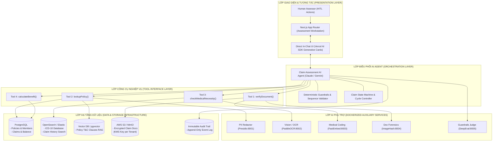

# 03. Kiến trúc Hệ thống Tổng thể (Enterprise System Architecture)

Tài liệu này đặc tả kiến trúc phân tán cấp doanh nghiệp cho hệ thống **Claims Assessment Copilot**, tích hợp lớp dữ liệu lớn (Big Data), công cụ tìm kiếm (Search Engine), hệ thống lưu trữ mã hóa và AI Agent điều phối.

---

## 1. Sơ đồ Kiến trúc Tổng thể (High-Level Architecture)



---

## 2. Lớp Hạ tầng Dữ liệu (Data & Storage Infrastructure)

Hệ thống được thiết kế theo nguyên tắc phân tách trách nhiệm (Separation of Concerns) nhằm tối ưu hiệu năng và đảm bảo an toàn thông tin y tế:

### 2.1. Cơ sở Dữ liệu Quan hệ (PostgreSQL / AWS RDS)

- **Nhiệm vụ:** Quản lý dữ liệu lõi với tính toàn vẹn giao dịch tuyệt đối (ACID).
- **Các bảng chính:**
  - `policies`: Thông tin hợp đồng, ngày hiệu lực, ngày hết hạn, mã sản phẩm.
  - `policy_benefits`: Cấu trúc quyền lợi chi tiết (Nội trú, Ngoại trú, Nha khoa, Thai sản), hạn mức năm (`annual_limit`), giới hạn mỗi lần khám (`limit_per_visit`), tỷ lệ đồng chi trả (`copay_percentage`).
  - `insured_persons`: Danh sách người được bảo hiểm, thông tin PO (Policy Owner) và IP (Insured Person).
  - `claims`: Bản ghi từng lượt bồi thường, trạng thái xử lý, số tiền yêu cầu, số tiền đã duyệt chi.
  - `benefit_balances`: Theo dõi hạn mức còn lại (`Balance = Limit - Claimed Amount`) theo từng kỳ bảo hiểm.

### 2.2. Kho Tài liệu Mã hóa & Tuân thủ Chính sách Xóa Dữ liệu (S3 + KMS)

- **Nhiệm vụ:** Lưu trữ ảnh scan, PDF hóa đơn, bệnh án của khách hàng.
- **Tuân thủ [Data Deletion Whitepaper](../requirements/Whitepapers/Data_Deletion.md) của Papaya:**
  1. **Soft Deletion (Giai đoạn Staging & Phục hồi):** Khi có yêu cầu xóa hồ sơ hoặc claim bị hủy, hệ thống cập nhật cờ `is_deleted = true`, gán nhãn `soft_deleted_at`. Dữ liệu được giữ lại 30–90 ngày để có thể phục hồi nếu xóa nhầm.
  2. **Cryptographic Erasure (Bảo mật tuyệt đối cho Claim Documents):**
     Tất cả tài liệu claim được mã hóa bằng **Envelope Encryption** với một khóa đối xứng (Data Encryption Key - DEK) được bảo vệ bởi Khóa chủ (Customer Master Key - CMK) trên AWS KMS. Khi khách hàng kích hoạt **Hard Deletion**, hệ thống lập tức hủy DEK/CMK tương ứng. Khi đó, toàn bộ các bản sao lưu (Daily/Weekly/Monthly snapshots) lập tức trở nên **vô dụng và không thể giải mã được**, đảm bảo tuân thủ GDPR/PDPA ngay lập tức mà không cần đợi chu kỳ xoay vòng backup.

### 2.3. Công cụ Tìm kiếm (Search Engine - OpenSearch / Elasticsearch)

- **Nhiệm vụ 1 — Tra cứu chuẩn hóa danh mục ICD-10:**
  - Lưu trữ toàn bộ 70.000 mã bệnh ICD-10 của WHO.
  - Sử dụng các bộ phân tích từ vựng (N-gram, Edge n-gram, Synonym Analyzer tiếng Việt/Anh) để hỗ trợ tìm kiếm mờ (Fuzzy Search). Bác sĩ gõ _"viêm họng"_ hay _"pharyngeal infection"_ đều map nhanh về mã chuẩn.
- **Nhiệm vụ 2 — Tìm kiếm lịch sử Claim & Phát hiện trùng lặp:**
  - Tìm kiếm tức thời trong hàng triệu claim cũ theo số CCCD/tên người bệnh để kiểm tra tần suất khám bệnh bất thường.

### 2.4. Lưu trữ Tri thức Điều khoản Hợp đồng (Hierarchical Policy Vector Store)

- **Nhiệm vụ:** Đảm bảo Agent trích dẫn điều khoản hợp đồng chính xác 100%, không bị ảo giác.
- **Cơ chế:** Văn bản Quy tắc bảo hiểm (T&C) được cắt thành các chunk phân cấp (Hierarchical chunks) và gắn metadata:
  ```json
  {
    "clause_id": "CLAUSE-EXCL-COSMETIC-01",
    "policy_id": "POL-2024-001",
    "section": "Điều 8: Các điểm loại trừ chung",
    "title": "Phẫu thuật thẩm mỹ và các can thiệp tự chọn",
    "content": "Bảo hiểm không chi trả cho mọi chi phí phẫu thuật thẩm mỹ, chỉnh hình nâng mũi, cắt mí mắt..."
  }
  ```
  Khi Agent thẩm định ca phẫu thuật nâng mũi, vector search sẽ trả về đúng chunk này kèm `clause_id` để Agent đưa vào báo cáo thẩm định.

---

## 3. Kiến trúc Điều phối AI Agent (Agentic Workflow & Guardrails)

```
[ Claim Request Ingestion ]
           │
           ▼
[ State: PENDING_ASSESSMENT ]
           │
           ▼
   +─────────────────────────────────────────────────────────────+
   |             RE-ACT TOOL CALLING SEQUENCE LOOP               |
   |                                                             |
   | 1. verifyDocument() ──► Check completeness, stamps, tampering|
   |         │                                                   |
   |         ▼                                                   |
   | 2. lookupPolicy()   ──► Check dates, limits, exclusions, RAG|
   |         │                                                   |
   |         ▼                                                   |
   | 3. checkNecessity() ──► Check diagnosis vs procedures match |
   |         │                                                   |
   |         ▼                                                   |
   | 4. calculateBenefit()─► Compute deduct, copay, apply balance|
   +─────────────────────────────────────────────────────────────+
           │
           ▼
[ Guardrail & Math Validation Layer ]
           │
           ├─► If Missing Required Docs ──► Recommendation: REQUEST_MORE_INFO
           ├─► If Excluded / Out of Date ──► Recommendation: REJECT
           └─► If Valid & Medically Sound──► Recommendation: APPROVE
           │
           ▼
[ Generate Structured Assessment Report ]
           │
           ▼
[ Append to Immutable Audit Trail ]
           │
           ▼
[ Render Direct UI (In-Chat Interactive Cards) for Assessor Review ]
```

### Các nguyên tắc cốt lõi:

1. **Deterministic Execution:** Việc tính toán tài chính (số tiền duyệt, copay, deductible) được thực thi bởi Engine toán học thuần túy (TypeScript Math Engine), tuyệt đối không để LLM tự tính nhẩm trong text.
2. **Immutable Audit Trail:** Mọi lượt gọi tool, tham số truyền vào, kết quả trả về và quyết định của Agent được ghi vào bảng log bất biến (`assessment_audit_events`), có timestamp và mã băm chống sửa đổi.

---

## 4. Tích hợp Direct UI (Generative UI trong Chatbox)

Sử dụng framework **Vercel AI SDK (`ai/react`)** kết hợp **Next.js App Router**:

- **Khung Chat hai chiều:**
  Assessor con người và AI Agent cùng làm việc trên cùng một luồng hội thoại.
- **Component tương tác nhúng trong Chat (Interactive Cards):**
  Khi Agent gọi tool `calculateBenefit`, khung chat sẽ stream ra component **`<BenefitCalculationCard />`**:
  - Hiển thị bảng chiết tính tiền viện phí trực quan (Số tiền yêu cầu, Mức miễn thường, Đồng chi trả, Số tiền duyệt).
  - Hiển thị thanh tiến trình hạn mức năm còn lại (`Progress Bar`).
  - Danh sách các điều khoản hợp đồng được trích dẫn kèm tooltip giải thích chi tiết.
  - Các nút hành động tương tác:
    - `[Duyệt bồi thường]` (Approve)
    - `[Yêu cầu bổ sung tài liệu]` (Request More Info)
    - `[Từ chối bồi thường]` (Reject)
    - `[Chỉnh sửa số tiền]` (Override Amount)
  - Khi Assessor nhấn một nút, action đó sẽ được gửi ngược lại cho Agent để hoàn tất quy trình và lưu vết audit log.
