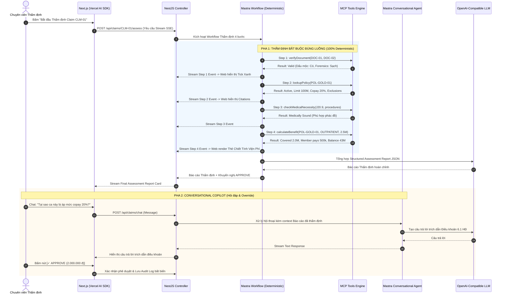

# 07. Bản Thiết kế Kiến trúc Công nghệ & Kế hoạch Triển khai (Tech Stack & Implementation Blueprint)

Tài liệu này tổng hợp toàn bộ các quyết định kiến trúc đã chốt qua phiên phân tích kỹ thuật (**`/agency-solution-engineer`** và **`/grill-me`**), xác lập cấu trúc Monorepo, luồng điều phối AI với Mastra, cơ chế MCP, và giao tiếp Direct UI.

---

## 1. Bản Đồ Tech Stack Đã Thống Nhất

| Tầng Kiến trúc | Công nghệ Lựa chọn | Vai trò & Lý do |
| :--- | :--- | :--- |
| **Quản lý Mã nguồn** | **pnpm workspace + Turborepo** | Monorepo tinh gọn: quản lý `apps/web`, `apps/api`, `packages/shared`, `packages/mcp-server`. |
| **AI Agent Engine** | **Mastra Core (`@mastra/core`)** | Mô hình **Hybrid**: **Workflow** ép 4 bước tuần tự cố định; **Agent** phục vụ chuyên viên chat hỏi đáp. |
| **LLM Provider** | **OpenAI-Compatible Endpoint** | Linh hoạt tối đa: hỗ trợ Ollama Cloud, local Ollama, OpenRouter, vLLM qua `.env` (`OPENAI_BASE_URL`). |
| **Backend Core** | **NestJS 10+** | Xương sống dịch vụ doanh nghiệp (Dependency Injection, Controllers, Modular Architecture). |
| **Giao thức Streaming** | **Server-Sent Events (SSE)** | NestJS stream execution graph của Mastra sang định dạng AI SDK (`ai/react`) cho Next.js. |
| **Frontend Workstation** | **Next.js 15+ (App Router)** | Màn hình Workstation Dual-Pane: Cột trái hồ sơ gốc, Cột phải khung chat Copilot. |
| **Chat AI & Generative UI**| **Vercel AI SDK (`ai/react` - `useChat`)** | Nhận stream SSE, tự động render các thẻ Generative UI Component trực tiếp trong chat. |
| **Styling & Icons** | **TailwindCSS thuần + `lucide-react`** | **Không dùng Shadcn CLI/AntD** để tránh cồng kềnh; chỉ dùng Tailwind thuần + Icon Lucide SVG. |
| **Lớp Dữ liệu & ORM** | **Prisma ORM (Hybrid Relational + JSON)** | Mặc định chạy **SQLite cục bộ** (chạy ngay không cần cài DB), sẵn sàng chuyển sang PostgreSQL. |
| **Công cụ Nghiệp vụ** | **MCP Tools (Dual-Export Package)** | 4 tools viết bằng pure TypeScript Zod, vừa làm **Stdio MCP Server** cho IDE, vừa import vào Mastra. |

---

## 2. Sơ đồ Cấu trúc Monorepo

```
/Users/tranquocdung/Projects/papaya-asign/
│
├── apps/
│   ├── web/                                 # Next.js 15+ Frontend Workstation
│   │   ├── src/app/                         # App Router (Trang Dashboard / Assessment)
│   │   ├── src/components/                  # Generative UI Cards (BenefitCard, CitationPill, Timeline)
│   │   └── tailwind.config.ts               # Cấu hình TailwindCSS
│   │
│   └── api/                                 # NestJS 10+ Backend Server
│       ├── src/modules/claims/              # Module quản lý Claims & DTOs
│       ├── src/modules/policies/            # Module tra cứu Hợp đồng
│       ├── src/modules/mastra/              # Mastra Engine (Workflow & Conversational Agent)
│       └── prisma/schema.prisma             # Schema Prisma (Hỗ trợ SQLite & PostgreSQL)
│
├── packages/
│   ├── shared/                              # Kiểu dữ liệu TypeScript & Zod schemas dùng chung
│   │   ├── src/types/claim.types.ts
│   │   ├── src/types/policy.types.ts
│   │   └── src/types/report.types.ts
│   │
│   └── mcp-server/                          # 4 MCP Tools lõi (Dual-Export)
│       ├── src/tools/verify-document.ts     # Tool 1: Kiểm tra chứng từ & mộc đỏ
│       ├── src/tools/lookup-policy.ts       # Tool 2: Tra cứu quyền lợi & trích dẫn điều khoản
│       ├── src/tools/check-necessity.ts     # Tool 3: Đối chiếu chẩn đoán ICD-10 & thủ thuật
│       ├── src/tools/calculate-benefit.ts   # Tool 4: Pure Math Engine tính Copay, Deductible, Limit
│       └── src/server.ts                    # Binary CLI chạy Stdio MCP Server cho Antigravity IDE
│
├── data/                                    # Dữ liệu mẫu (3 Test Cases & SQLite DB)
│   ├── papaya_claims.db                     # File SQLite local (tự sinh khi nạp Prisma)
│   └── fixtures/                            # Dữ liệu JSON của 3 test cases
│
├── docs/                                    # Toàn bộ tài liệu kiến trúc kỹ thuật
└── .agents/                                 # Cấu hình Antigravity IDE (Rules, Skills, mcp_config.json)
```

---

## 3. Chi tiết Luồng Xử lý Hybrid trong Mastra



---

## 4. Kế hoạch Triển khai Thực chiến (Milestones)

1. **Pha 1 — Khởi tạo Monorepo & Shared Types:**
   * Cấu hình `pnpm-workspace.yaml`, TypeScript config dùng chung.
   * Tạo `packages/shared` chứa Zod Schemas và Types (`Claim`, `Policy`, `AssessmentReport`).
2. **Pha 2 — Xây dựng 4 MCP Tools Engine (`packages/mcp-server`):**
   * Viết logic pure TypeScript: `verifyDocument`, `lookupPolicy`, `checkMedicalNecessity`, `calculateBenefit`.
   * Cấu hình Stdio MCP Server trong [.agents/mcp_config.json](file:///Users/tranquocdung/Projects/papaya-asign/.agents/mcp_config.json).
   * Viết Unit Tests cho 3 kịch bản: `APPROVE`, `REJECT`, `REQUEST_MORE_INFO`.
3. **Pha 3 — Xây dựng Backend NestJS & Mastra Engine (`apps/api`):**
   * Cài đặt NestJS, tích hợp Prisma ORM (SQLite file).
   * Tạo Mastra Workflow (4 steps tuần tự) và Mastra Agent.
   * Tạo Controller xuất luồng SSE stream tương thích chuẩn Vercel AI SDK.
4. **Pha 4 — Xây dựng Frontend Next.js Workstation (`apps/web`):**
   * Tạo giao diện Dual-Pane Workstation bằng TailwindCSS + Lucide.
   * Tích hợp hook `useChat` nhận stream SSE từ NestJS.
   * Tạo các component Generative UI: `ToolExecutionTimeline`, `BenefitCalculationCard`, `PolicyCitationPill`.
   * Tích hợp 4 Action Modals (Approve, Reject, Request More Info, Override).
5. **Pha 5 — Kiểm thử Tích hợp & Đóng gói Nộp bài:**
   * Chạy end-to-end trên 3 test cases mẫu.
   * Kiểm tra xuất file AI Conversation log phục vụ nộp bài theo quy định Papaya.
